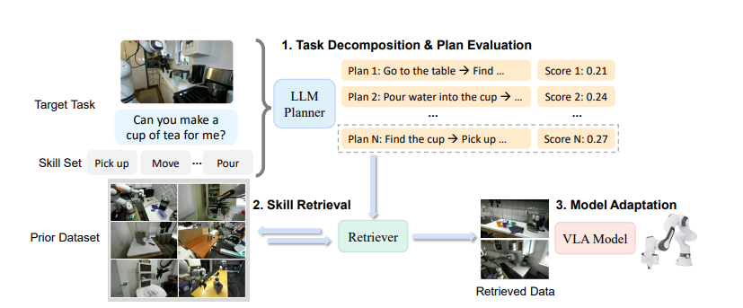
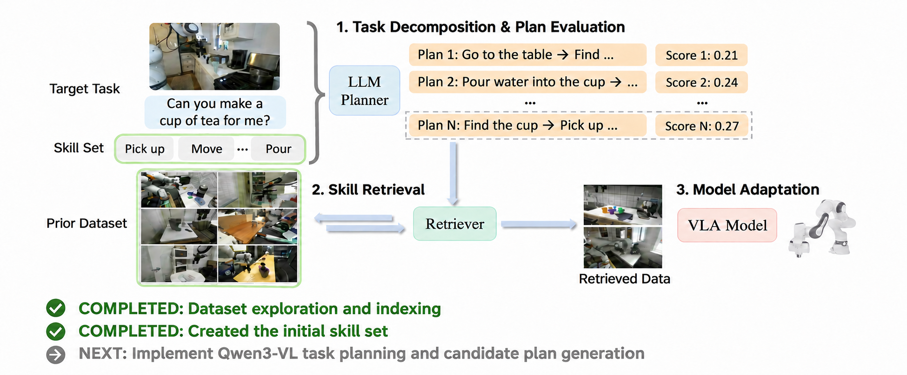

# HSR — Hierarchical Skill Retrieval Replication

Independent replication of [Hierarchical Skill Retrieval (HSR)](https://arxiv.org/pdf/2608.24042), a framework for data-efficient adaptation of Vision-Language-Action (VLA) models.

We aim to reproduce the paper's methodology using **SmolVLA-450M**, **LIBERO-90**, and **LIBERO-10**, then investigate potential improvements.

Development uses Python, PyTorch, Hugging Face, and Jupyter notebooks on the University of Florida's HiPerGator HPC cluster.

## HSR overview

The framework decomposes a target task, retrieves relevant skills from prior demonstrations, and uses the retrieved data for model adaptation.

## Getting started on HiPerGator

Open [the setup notebook](notebooks/000_hipergator_setup.ipynb) for environment creation, LIBERO installation, and the LIBERO-90/10 dataset download. Replace `FILLMEIN` with your HiPerGator username and adjust `/blue/uf-eig` if your allocation uses a different path. The existing notebooks expect the project at `/blue/uf-eig/FILLMEIN/HSR-Replication` and datasets in its `datasets` directory.

The initial environment follows [LIBERO's installation instructions](https://github.com/Lifelong-Robot-Learning/LIBERO#installation); later SmolVLA work may need a separate, newer environment.

## Progress

- [x] **01 — Dataset Exploration:** LIBERO setup, HDF5 demonstrations, action analysis, and dataset indexing.
- [x] **02 — Skill Discovery:** BERT instruction embeddings, K-means clustering (K=10), and demonstration-to-skill mapping.

## Remaining Work

- [ ] **03 — Task Decomposition:** Implement Qwen3-VL task planning and candidate plan generation.
- [ ] **04 — Skill Confidence:** Estimate skill reliability using held-out behavior-cloning losses.
- [ ] **05 — Hybrid Skill Retrieval:** Implement language-based retrieval and VAE-based behavior reranking.
- [ ] **06 — SmolVLA Adaptation:** Integrate LIBERO with SmolVLA, implement fine-tuning, and prepare the two-stage adaptation pipeline.
- [ ] **07 — Evaluation & Ablations:** Reproduce LIBERO-10 success rates, baseline comparisons, and ablation experiments.

**Research priority:** Faithful replication of the paper before introducing architectural changes or optimizations.

## Paper

[Hierarchical Skill Retrieval — arXiv:2608.24042](https://arxiv.org/pdf/2608.24042)
